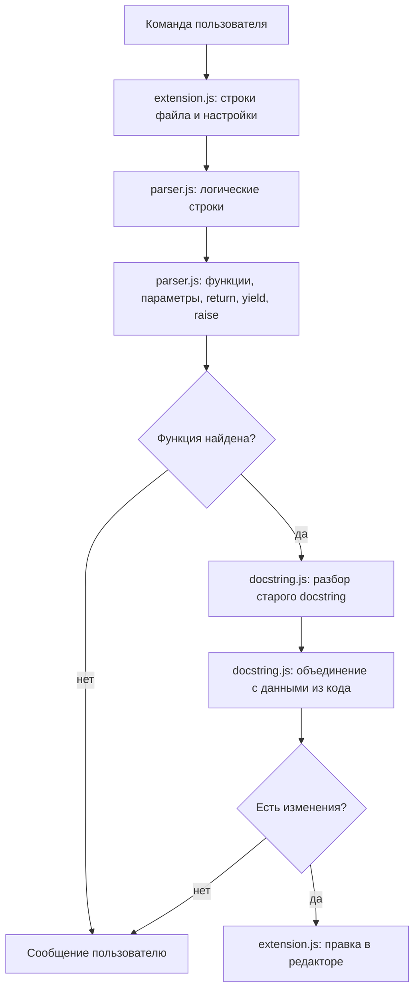

# Документация проекта

## Техническое задание

1. Расширение для VS Code, работающее с файлами Python.
2. Команда «документировать функцию под курсором».
3. Команда «документировать все функции файла».
4. Docstring в стиле Google с разделами `Args`, `Returns` или `Yields`, `Raises`.
5. При обновлении сохраняются описания, написанные человеком.
6. Повторный запуск без изменения кода ничего не меняет.
7. Если команду выполнить нельзя, показывается сообщение.

## Архитектура

| Файл | Назначение | Зависит от VS Code |
|---|---|---|
| `src/parser.js` | разбор кода Python | нет |
| `src/docstring.js` | генерация и обновление документации | нет |
| `src/extension.js` | команды и работа с редактором | да |
| `package.json` | манифест: команды, клавиши, меню, настройки | |
| `test/docstring.test.js` | тесты | нет |

## Структуры данных и алгоритмы

| Что | Где | Зачем |
|---|---|---|
| Стек скобок | `toLogicalLines` | понять, продолжается ли инструкция на следующей строке |
| Стек скобок | `splitTopLevel`, `findTopLevel`, `matchingBracket` | не делить параметры по запятым внутри `dict[str, int]` |
| Состояние кавычки | `toLogicalLines` | не принимать содержимое строк за код |
| Стек блоков | `parseFunctions` | отличать методы класса от обычных функций |
| Множество `Set` | `analyzeBody` | перечислить исключения без повторов |
| Словарь `Map` | `parseDocstring` | «раздел → строки» с сохранением порядка |
| Словарь `Map` | `parseEntries` | «параметр → описание» для переноса при обновлении |

**Разбор** идёт за один проход по символам: строки склеиваются, пока открыты скобки, многострочный литерал или стоит `\`. Для каждой логической строки хранится копия, где содержимое строковых литералов заменено на `_`; поиск ключевых слов выполняется по ней.

**Обновление:** старый docstring делится на описание и разделы. Параметры берутся из кода, а описания по имени из словаря. Правки для всего файла применяются снизу вверх, чтобы номера строк выше не сдвигались.

## Основные функции

| Функция | Результат |
|---|---|
| `parseFunctions(lines)` | список функций с параметрами и результатами анализа тела |
| `findFunctionAt(functions, line)` | самая внутренняя функция на строке |
| `documentAt(lines, cursorLine, options)` | найденная функция и правка |
| `documentAll(lines, options)` | правки для всех функций и причины пропусков |
| `buildEdit(lines, fn, options)` | правка или `null`, если менять нечего |
| `applyEdit(lines, edit)` | новый массив строк |

Описания всех функций и их параметров находятся в комментариях JSDoc в исходном коде.

## Подключение к VS Code

Расширение запускается в отдельном процессе Extension Host. VS Code читает `package.json`: раздел `contributes` объявляет команды, сочетание клавиш, пункт меню и настройку. При открытии файла Python вызывается `activate`, который регистрирует обработчики через `vscode.commands.registerCommand`. Текст изменяется методом `TextEditor.edit`.
